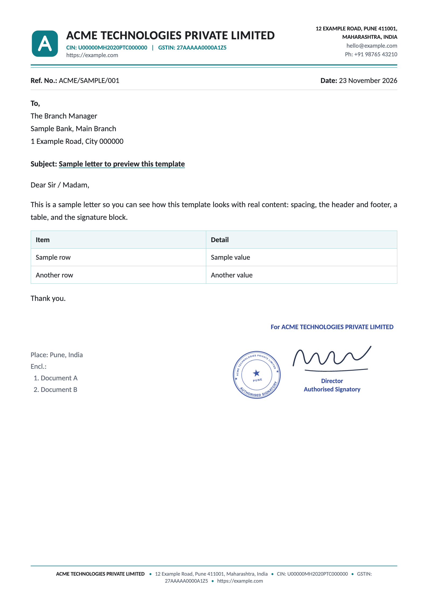
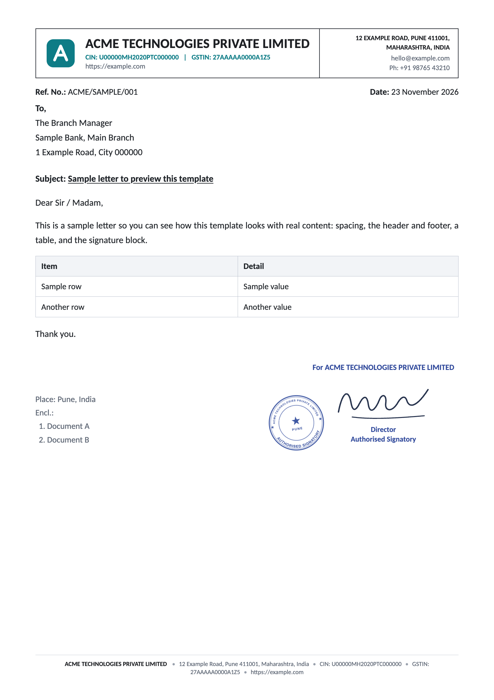
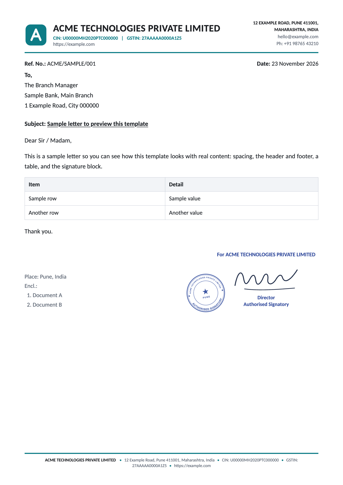
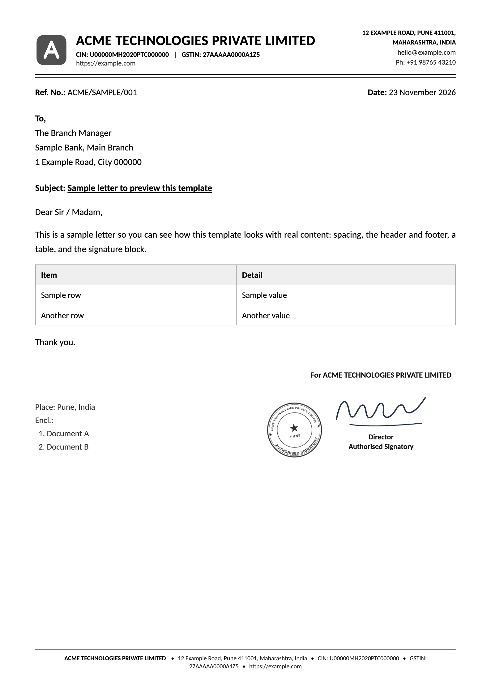
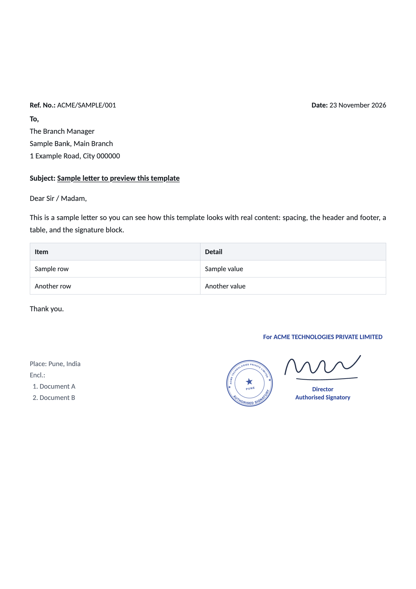

# Letterhead

Make a proper company letterhead and generate numbered letters by chatting with [Claude Code](https://claude.com/claude-code).
Runs entirely on your machine: no server, no cloud, nothing to host. Built with Indian business letters in mind
(LLPIN / CIN / GSTIN, financial-year numbering, A4/A5), but works for any company.

## How it works

1. **Clone this repo, open it in Claude Code, run `npm install`.**
2. **Say "set up our letterhead".** The `setup-letterhead` skill asks for your company details, asks you to drop
   `logo.svg` and `signature.svg` (a PNG works too; see `.claude/skills/setup-letterhead/signature-svg.md` for getting an SVG) into `company/assets/`, builds five looks (classic, boxed, modern, plain black-and-white, stationery for pre-printed paper) for you to pick from,
   and creates a private git repo in `company/` for your data.
3. **Then just ask for letters.** "Letter to the bank manager asking to update our signatory, with signature."
   The `new-letter` skill numbers it (`ACME/2026-27/004`), writes it, and opens it in your browser.
   Click **Print / Save as PDF** (paper A4, Scale 100%, Headers and footers off) or **Download PDF**. A PDF copy is also saved if Chrome/Edge is installed.

## Templates

Five looks, each in A4 and A5. Your logo, colours and details drop into whichever you pick (below: a fictional "Acme" company).

| Classic (default) | Boxed | Modern |
|:--:|:--:|:--:|
|  |  |  |
| No boxes; thin double rule under the header, all lines in your colour | Framed header and signature box | Open header, bold accent rules |

| Plain (black and white) | Stationery |
|:--:|:--:|
|  |  |
| For photocopies, fax and mono printers | No header or footer, for pre-printed paper |

Browse the interactive gallery with both sizes: open [docs/templates/index.html](docs/templates/index.html) after cloning (or enable GitHub Pages on the `/docs` folder to get a web link). Once set up, `npm run preview -- --open` shows the same gallery with **your** company details.

## Multi-page and signing
Normal letters carry no signature image. For undertakings and letters with annexures the agent asks how to sign and
supports: signature + seal on the last page, a small signature (and/or seal) on **every** page, signature + seal on the
cover page only or cover page plus initials on the rest, a round company seal and/or a square signatory stamp ("For <company>", signature inside, "Director / Authorised Signatory" below), `\pagebreak` for annexures, and "Page X of Y".
The signature block is always kept with the last paragraph, so it never ends up alone on a page.

## Repo layout

| Path | What | Public? |
|------|------|---------|
| `src/`, `templates/`, `starter/`, `.claude/skills/` | the engine, four templates (A4 + A5), skills | yes |
| `company/` | your `config.json`, logo, signature, `letters/` (text), `generated/` (every draft and final), `approved/` (signed-off copies), `START-HERE.md` | **no**: gitignored here; its own private repo |

Your company data can never be committed to this repo by accident: `company/` is in `.gitignore`.
Update the engine any time with `git pull`; your `company/` folder is untouched.

## For non-developers

You don't write code or touch files. You chat; the assistant does the rest.

1. Install **Node.js** (the LTS installer from nodejs.org) and **Google Chrome**, once. The assistant can walk you through this.
2. Open this folder in **Claude Code**, which also comes as a desktop app (no terminal needed), and say **"set up our letterhead"**.
3. Afterwards just ask for letters. Review the draft in your browser, ask for changes in plain words, then say **"approve it"**.

Your private `company/` folder is organised for people, not programmers (see `company/START-HERE.md`, written for you during setup):

- **`generated/`**: every letter the assistant has made. Open `index.html` to browse, review, print or download as PDF.
- **`approved/`**: the final, signed-off copies. Open `index.html` to find the one to send.

## Where it runs

| Where | Works? |
|---|---|
| **Claude Code**: terminal, desktop app, web, IDE extensions | Yes. This is what it is built and tested for. |
| Other coding agents | Probably: the instructions are plain Markdown (`AGENTS.md` points to them). Untested. |
| Chat-only apps (claude.ai, Claude desktop chat) | Not supported. The tool needs a folder on your computer that persists, Node.js, and the ability to run commands, which a chat session does not give you. |

## Commands
```
npm run doctor                               check your setup
npm run templates                            list looks and sizes
npm run preview -- --open                    see every template in your browser
npm run new -- acme-quote --template modern --size A4
npm run letter -- company/letters/<file>.md --open
npm run approve -- <letter-name>             copy a reviewed letter into company/approved/
npm run all | blank | index
```
Custom looks: copy a folder from `templates/` to `company/templates/<name>/` and edit the CSS.

## Security
The signature image lives in your private `company/` repo, so anyone with access can issue letters in that person's name.
Restrict access, and note signature and seal are opt-in per letter (`sign: true`, `seal: true`).

## Disclaimer
The India notes in `.claude/skills/setup-letterhead/india-notes.md` are general guidance, not legal advice.
Confirm requirements for your entity type with your CA or Company Secretary.

## License
MIT. See [LICENSE](LICENSE).
